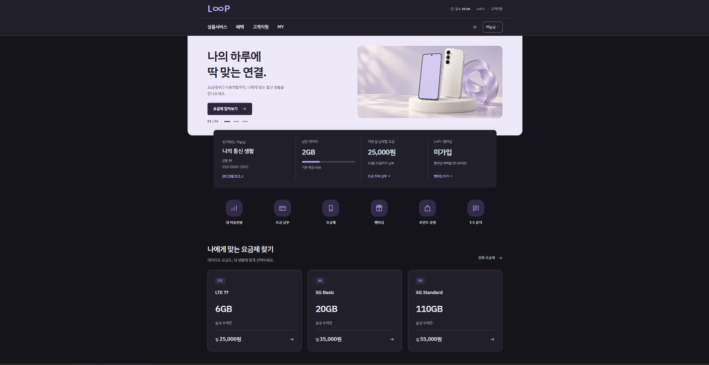
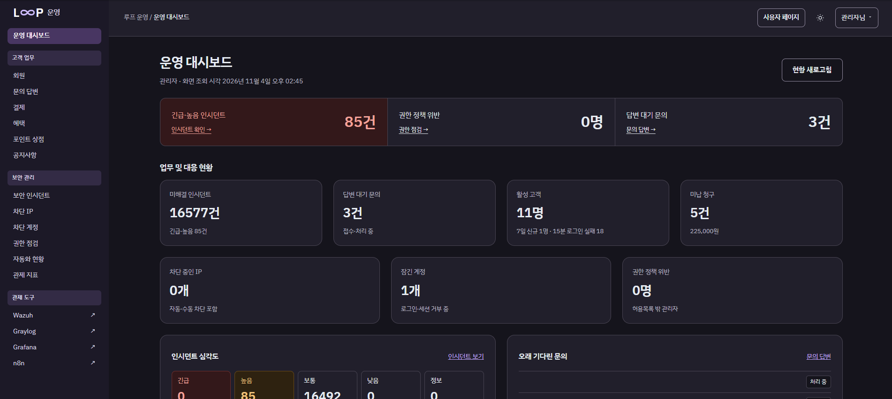
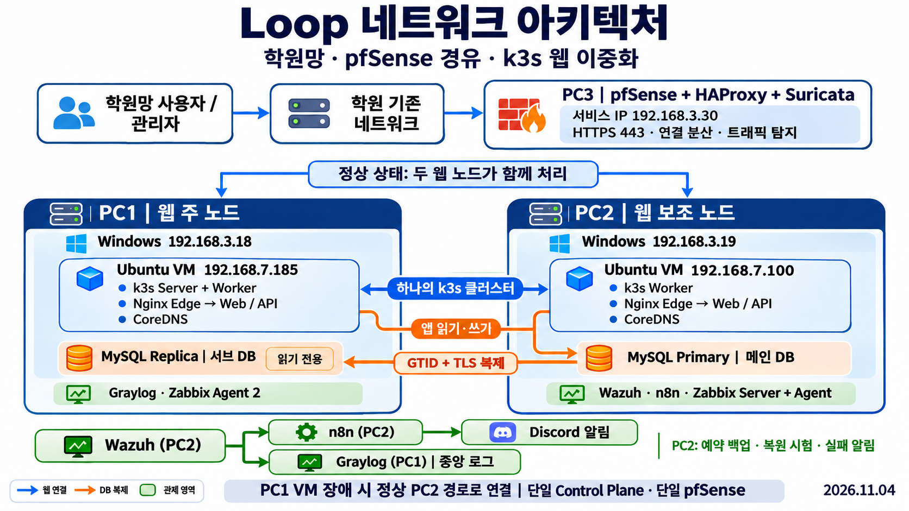
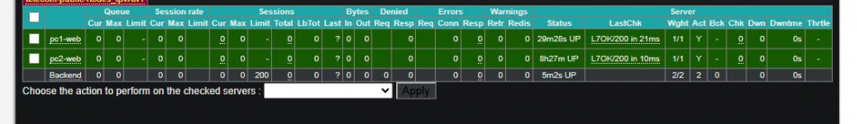
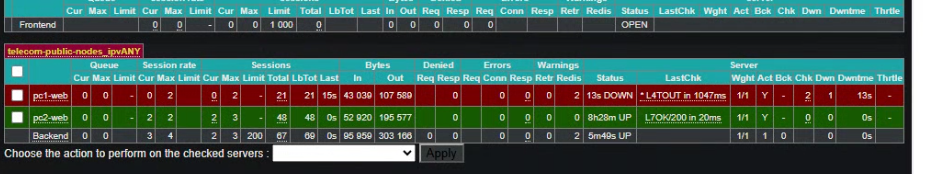
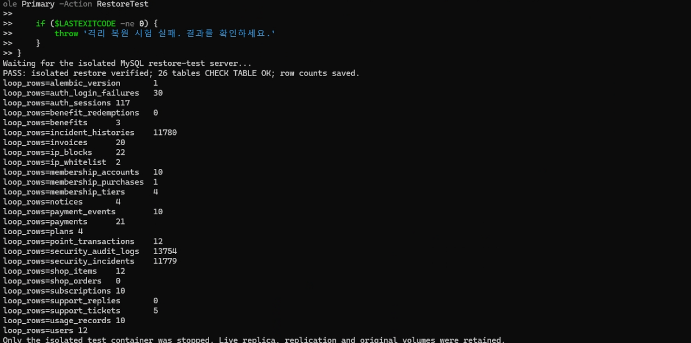
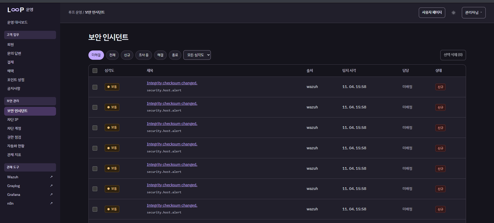

# LOOP · 통신사 보안 관제와 서비스 연속성

LOOP는 학원 실습망에 구축한 **4인 가상 통신사 프로젝트**입니다. 고객은 이용량과 청구 내역을 조회하고 멤버십과 포인트를 이용합니다. 운영자는 별도 관리 화면에서 고객 업무와 보안 인시던트를 처리합니다. 팀은 이 웹 서비스를 두 노드에 배포하고, 장애 시 요청 처리와 데이터 복원, 보안 이벤트의 탐지부터 알림까지 시험했습니다.

**최종 발표 기준 성과** · 웹 노드 2대 · PC1 VM 중단 시험에서 HTTP 200 응답 224건 · 격리 복원에서 MySQL 테이블 26개 검사 통과

[주요 기능과 검증 결과](#주요-기능과-검증-결과) · [시스템 구성](#시스템-구성) · [검증 화면](#검증-화면) · [팀원별 기여](#팀원별-기여) · [PC1 단일 장비 설치 및 이관](#pc1-단일-장비-설치-및-이관)



## 개인 포크 개선 · 로그인 시간

고객 화면과 운영 콘솔에 남은 접속 시간을 `01:00:00`부터 표시합니다. 시간이 다 되면 자동 로그아웃됩니다. 만료 전에 **연장**을 누르면 누른 시점부터 다시 최대 1시간 동안 사용할 수 있습니다. 최초 로그인부터 8시간이 지나면 다시 로그인해야 합니다.

서버가 공유 DB의 세션 만료 시각을 검사하며, 일반 화면 조회로 만료 시각이 갱신되지 않습니다. [인증 API 계약](docs/contracts/auth-api.md)

## 주요 기능과 검증 결과

| 영역 | 구현 및 검증 |
|---|---|
| **고객 서비스와 운영 콘솔** | 고객 포털에 이용량·요금·청구, 멤버십·포인트 상점, 공지와 1:1 문의를 구현했습니다. Flask API가 로그인 세션, 고객·관리자 역할, 데이터 소유권을 검사합니다. |
| **웹 배포와 장애 대응** | PC1·PC2의 Ubuntu VM에 Web·API·Nginx Edge를 배치했습니다. 10월 30일 PC1 VM 중단 시험에서 웹 112건과 API 112건이 모두 HTTP 200을 반환했습니다. PC2 DB를 유지한 상태에서 측정한 결과입니다. |
| **DB 복제와 복원** | PC2 MySQL Primary의 변경을 PC1 읽기 전용 Replica에 GTID와 TLS로 복제합니다. PC2의 시간당 백업을 시험 컨테이너에 복원해 테이블 26개를 검사했고, 백업 실패와 정상화 메시지를 Discord에서 확인했습니다. |
| **접근 통제와 보안 관제** | PC3 pfSense에서 고객용 HTTPS, 관리 접속, 자동화 API 입구를 구분했습니다. Wazuh의 포트 스캔 탐지와 시험 파일 생성·수정·삭제 탐지를 확인하고, 인시던트 등록과 Discord 알림을 검증했습니다. |



## 시스템 구성



- **PC3 · 네트워크 진입점** — pfSense가 접속 정책을 적용하고, HAProxy가 HTTPS 연결을 두 웹 노드로 분산합니다. Suricata는 설정된 인터페이스의 트래픽을 감시합니다.
- **PC1 · k3s 제어부 및 웹 노드** — Web·API·Nginx Edge, CoreDNS, 읽기 전용 MySQL Replica, Graylog, Zabbix Agent를 운영합니다.
- **PC2 · k3s 웹 노드 및 DB Primary** — Web·API·Nginx Edge, CoreDNS, 쓰기 가능한 MySQL Primary, Wazuh, n8n, Zabbix Server와 Agent를 운영합니다.

## 검증 화면

### 웹 연결 분산과 노드 장애

평상시 HAProxy는 Round Robin으로 두 노드에 새 TCP 연결을 나눕니다. HTTPS 상태 검사가 실패한 노드를 제외하고, 복구 후 검사에 통과하면 다시 연결을 전달합니다.

초기 중단 시험에서는 살아 있는 노드의 Nginx가 다른 노드의 API로 연결을 시도해 502와 504가 발생했습니다. 각 Edge가 같은 노드의 Web·API로 요청을 보내도록 변경하고, HAProxy가 API와 DB 연결 상태까지 확인하도록 구성했습니다.




### 백업 파일의 실제 복원

PC2 Primary의 백업을 별도의 MySQL 컨테이너에 불러와 `CHECK TABLE`과 행 수를 확인했습니다. Discord 감시는 백업 실패와 이후 정상화를 각각 기록했습니다.



### 탐지 이벤트와 인시던트

Wazuh의 탐지 이벤트를 Graylog와 n8n에 각각 전달합니다. Graylog에서는 원본 로그를 검색하고, n8n은 이벤트를 웹 인시던트로 등록하고 Discord에 알립니다. 운영자는 인시던트 목록에서 심각도·출처·상태를 확인할 수 있습니다.



## 팀원별 기여

| 팀원 | 담당 | 주요 기여 |
|---|---|---|
| **김준식** | 웹·DB 개발 | React 고객·관리자 화면, Flask 인증·업무 API, 요금·결제·멤버십·포인트 상점, 데이터 모델 구현 |
| **문경구** | 인프라·이중화 | Docker 이미지 빌드와 k3s 배포, HAProxy 연동과 웹 장애 시험, MySQL 역할 전환·복제·예약 백업·격리 복원·실패 감시 |
| **정동석** | 네트워크·보안 | pfSense 인터페이스·방화벽·NAT, 관리 접속과 VPN, 인증서 협업, Suricata 설정과 보안 시나리오 검증 |
| **김준오** | 보안 관제·자동화 | Wazuh 탐지 규칙, Graylog 로그 수집·검색, Zabbix·Grafana 지표, n8n 인시던트·Discord 알림 연동 |

## 팀 실습망 운영 범위

웹 실행본은 두 노드에 분산했으며 k3s 제어부는 PC1 한 대, 서비스 진입점은 PC3 한 대입니다. DB 승격과 접속 대상 변경은 수동 절차입니다.

## 기술 스택과 저장소 구조

| 경로 | 기술 및 내용 |
|---|---|
| [frontend/](frontend/) | React, TypeScript, Vite |
| [backend/](backend/) | Flask, Gunicorn, SQLAlchemy |
| [database/](database/) | MySQL 8.4 스키마, 마이그레이션과 초기 데이터 |
| [infrastructure/](infrastructure/) | Docker, k3s, Nginx 배포와 운영 도구 |
| [network/](network/) · [security/](security/) | 학원망 설계, pfSense, HAProxy, OpenVPN, Suricata와 Wazuh |
| [monitoring/](monitoring/) | Graylog, Zabbix, Grafana, n8n과 Discord 연동 |
| [tests/](tests/) · [docs/](docs/) | 기능·보안 시험, 연동 계약, 검증 기록과 운영 절차 |

## 운영 문서

- **배포와 점검** · [인프라 시작 가이드](docs/operations/infra-start-here.md) · [매일 시작·종료](docs/runbooks/k3s-mysql-daily-operations.md) · [검증 기록](docs/operations/infra-verification.md)
- **웹 이중화와 DB** · [이중화·복제 운영 기록](docs/operations/2026-10-29-web-ha-replication.md) · [PC2 Primary 백업과 복원](docs/runbooks/mysql84-primary-backup.md) · [예약 백업](docs/runbooks/mysql84-primary-schedule.md)
- **접근과 연동** · [관리자 접속](docs/runbooks/academy-admin-access.md) · [자동화 전용 입구](docs/runbooks/academy-automation-ingress.md) · [공통 계약](docs/contracts/README.md) · [환경변수 명세](docs/contracts/environment-variables.md)
- **초기 설계와 구축 이력** · [10월 23일 네트워크 구성](network/diagrams/academy-k3s-20261023.md) · [주소](network/address-plan.md) · [포트](network/port-matrix.md) · [설계 근거](docs/architecture/academy-network-20261023.md)

## 협업

`main`은 안정 버전이며 `develop`은 공동 통합 브랜치입니다. 기능 브랜치와 PR 운영 방식은 [협업 및 커밋 규칙](CONTRIBUTING.md)을 참고하세요.

## PC1 단일 장비 설치 및 이관

문경구는 팀 실습 환경의 웹과 DB를 개인 포트폴리오에서 재현할 수 있도록 Windows PC1 한 대로 옮겼습니다. 기존 k3s 웹 배포가 들어 있는 Ubuntu VM 두 대와 PC1 Docker의 MySQL 데이터 볼륨을 재사용했습니다. Graylog, Wazuh, n8n도 PC1 Docker에서 실행 상태를 확인했습니다.

### 1. 저장소와 실행 환경 준비

PC1 Windows에서 개인 저장소를 클론합니다. VMware Workstation에서 기존 `loop-web` VM을 열고, 가져온 `loop-pc2` VM을 추가합니다. Docker Desktop을 실행하고 기존 MySQL과 관제 컨테이너를 확인합니다. 환경변수 이름은 [`.env.example`](.env.example)에 정리되어 있습니다.

```powershell
git clone https://github.com/gyeonggumun/telecom-security-project.git
Set-Location telecom-security-project
docker ps --format 'table {{.Names}}\t{{.Status}}\t{{.Ports}}'
```

### 2. 두 Ubuntu VM을 같은 VMware 내부망에 연결

두 VM의 네트워크 어댑터를 같은 VMware Host-only 네트워크에 연결했습니다. Ubuntu에서는 `/etc/netplan/99-loop-local.yaml`에 `br0`의 고정 주소를 설정하고 `sudo netplan generate`로 설정을 검사했습니다.

| 장비 | 주소 | 역할 |
|---|---|---|
| PC1 Windows VMware 어댑터 | `192.168.91.1/24` | MySQL `flask_mysql`의 접속 주소 |
| `loop-web` Ubuntu VM | `192.168.91.20/24` | k3s 제어부·실행 노드, 웹 NodePort `30080` |
| `loop-pc2` Ubuntu VM | `192.168.91.21/24` | k3s 실행 노드 |

Windows 방화벽에서 `192.168.91.1`의 TCP `3306`을 두 VM 주소에만 허용하고, 각 VM에서 연결을 확인했습니다.

```bash
ip -br -4 addr show br0
nc -vz -w 3 192.168.91.1 3306
```

### 3. PC1 MySQL에 API 연결

PC1 `flask_mysql`에서 기존 팀 PC2를 향하던 `pc2_to_pc1` 복제 채널을 중지하고 재시작 시 복제가 자동으로 시작되지 않게 설정했습니다. PC1 DB의 `read_only`와 `super_read_only`를 해제해 쓰기를 허용했습니다. 두 API는 `webuser`로 `192.168.91.1:3306`의 `my_new_board_db`에 연결합니다.

아래 SQL은 개인 환경으로 옮긴 PC1 DB에 기존 `pc2_to_pc1` 복제 채널이 남아 있는 경우에 사용합니다. PC1 Windows에서 `docker exec -it flask_mysql mysql --user=root --password`로 접속해 실행합니다.

```sql
STOP REPLICA FOR CHANNEL 'pc2_to_pc1';
SET PERSIST_ONLY skip_replica_start = ON;
SET PERSIST super_read_only = OFF;
SET PERSIST read_only = OFF;
```

제어부 VM에서 `DB_HOST`, `DB_PORT`, `DB_NAME`, `DB_USER`, `DB_PASSWORD`를 권한 `600`인 `$HOME/.loop-db.env`에 저장하고 `telecom-local-db` Secret으로 적용합니다. `DB_PASSWORD`는 PC1의 `webuser` 비밀번호를 사용합니다.

```bash
sudo k3s kubectl -n telecom create secret generic telecom-local-db \
  --from-env-file="$HOME/.loop-db.env" --dry-run=client -o yaml |
  sudo k3s kubectl apply -f -
sudo k3s kubectl -n telecom set env deployment/telecom-api --from=secret/telecom-local-db
sudo k3s kubectl -n telecom rollout status deployment/telecom-api
sudo k3s kubectl -n telecom get pods -l app=telecom-api -o wide
```

두 API Pod가 각각 `1/1 Running` 상태가 된 뒤 PC1 브라우저에서 LOOP 로그인 화면을 열었습니다. 상태 확인 API는 HTTP `200`과 `database: ok`를 반환했습니다.

```powershell
curl.exe --noproxy '*' --fail --silent --show-error http://192.168.91.20:30080/api/health/ready
```

### 4. PC1 관제 설정 가져오기

1. `docker port gl-graylog`로 Graylog의 Windows 접속 포트를 확인합니다. Graylog의 **System → Content Packs → Upload**에서 `monitoring/graylog/Graylog_Wazuh분할.json`을 업로드해 `Graylog 6.1 - Wazuh 역할분리 19ED` 팩을 확인했습니다.
2. `http://localhost:5678/`에서 n8n에 접속합니다. `monitoring/n8n/workflows/n8n_경로_실사용URL_적용.json`의 복사본에서 팀 웹훅과 API 인증값을 제거하고 새 ID를 부여한 뒤, `LOOP PC1 - GitHub staged`라는 별도 워크플로로 가져왔습니다. 아래 명령에서 `loop-n8n-staged.json`은 이렇게 준비한 복사본입니다.
3. Graylog 컨테이너에서 n8n 상태 확인 주소에 요청해 `ok` 응답을 확인했습니다.

```powershell
docker cp .\loop-n8n-staged.json n8n:/tmp/loop-n8n-staged.json
docker exec -u node n8n n8n import:workflow --input=/tmp/loop-n8n-staged.json
docker exec gl-graylog curl -fsS --max-time 5 http://host.docker.internal:5678/healthz
```

### 이관 중 해결한 문제

| 증상 | 원인과 해결 | 확인 결과 |
|---|---|---|
| API 상태 검사에서 `503` 반환 | 배포의 `DB_HOST`가 기존 물리 PC2 주소 `192.168.3.19`를 가리켰습니다. PC1 VMware 어댑터 주소를 Secret으로 주입하고 두 VM의 DB 접근을 방화벽에서 허용했습니다. | 두 VM에서 PC1 MySQL의 TCP `3306`에 연결했습니다. |
| DB 주소를 바꾼 뒤 MySQL `1045` 반환 | 기존 API 자격 증명이 PC1 MySQL의 `webuser`와 일치하지 않았습니다. PC1의 계정과 Secret의 비밀번호를 맞추고 API를 다시 배포했습니다. | API Pod 두 개가 준비 상태가 됐고 상태 검사에서 `database: ok`를 확인했습니다. |
| PC1 DB에 팀 환경의 복제와 읽기 전용 설정이 남아 있었음 | 기존 PC2로 향하던 복제를 중지하고 자동 재시작을 막았습니다. PC1의 읽기 전용 설정을 해제했습니다. | PC1 MySQL을 개인 환경의 쓰기 DB로 사용하도록 설정했습니다. |
| n8n 가져오기 파일에 팀 인증값과 기존 워크플로 ID가 포함됨 | 로컬 복사본에서 팀 인증값을 제거하고 새 워크플로 ID를 사용했습니다. | PC1 n8n에서 별도로 가져온 워크플로를 확인했습니다. |
